# Dentalkart Clone – Database Design (MySQL 8)

Companion to [ARCHITECTURE.md](ARCHITECTURE.md). Every table the whole product needs.
Phase-1 tables are marked **[P1]**.

## 0. Conventions

* Engine InnoDB, charset `utf8mb4`. PK = `id BIGINT UNSIGNED AUTO_INCREMENT`. FK column = `<singular>_id`.
* `created_at`, `updated_at` on every table (omitted below). `SD` = also `deleted_at` (soft delete).
* Money `DECIMAL(12,2)` (PKR). Percent `DECIMAL(5,2)`. Coins `INT`.
* `status` / `type` columns are `VARCHAR(30)` mapped to PHP backed enums (not MySQL ENUM → easy to extend). Allowed values are listed in the notes.
* `JSON` columns for flexible, non-filtered data only.
* Images/files use **spatie medialibrary** (`media` table). A note like "media: icon, image" means those media collections exist on the model; no column.
* "Snapshot" = value copied at the time of the event so history never changes.
* Notation: `col TYPE [constraints] – note`. `→ table` = foreign key. `UQ` unique, `IX` index.

---

## 1. Entity map (relationships only)

```mermaid
erDiagram
  users ||--o{ user_addresses : has
  users ||--o{ wishlists : owns
  wishlists ||--o{ wishlist_items : contains
  wishlists ||--o{ wishlist_shares : shared_via
  users ||--o{ product_reviews : writes
  users ||--o| reward_wallets : has
  users ||--o{ reward_transactions : ledger
  users ||--o{ user_memberships : buys
  membership_plans ||--o{ user_memberships : plan
  users ||--o{ carts : has
  users ||--o{ orders : places

  company_registration_types ||--o{ companies : registered_as
  vendor_types ||--o{ companies : vendor_type
  countries ||--o{ companies : origin
  companies ||--o{ brands : owns
  companies ||--o{ products : supplies
  brands ||--o{ products : labels
  categories ||--o{ sub_categories : has
  categories ||--o{ products : category
  sub_categories ||--o{ products : sub_category

  products ||--o{ product_variants : has
  products ||--o{ product_images : has
  products ||--o{ product_content_tabs : has
  products ||--o{ product_reviews : receives
  products ||--o{ product_questions : asked
  products }o--o{ tags : tagged
  products }o--o{ collections : in
  products ||--o{ product_channels : visible_on
  sales_channels ||--o{ product_channels : channel
  product_variants ||--o{ variant_channel_stock : stock
  sales_channels ||--o{ variant_channel_stock : channel
  product_variants ||--o{ variant_price_tiers : tiers

  carts ||--o{ cart_items : has
  product_variants ||--o{ cart_items : line
  orders ||--o{ order_items : has
  orders ||--o{ order_addresses : ships_to
  orders ||--o{ order_status_history : timeline
  orders ||--o{ shipments : fulfilled_by
  shipments ||--o{ shipment_events : tracking
  orders ||--o{ payments : paid_by
  orders ||--o{ return_requests : returns
  return_requests ||--o{ return_request_items : lines
  orders ||--o{ invoices : invoiced
  orders ||--o{ refunds : refunded
  coupons ||--o{ coupon_usages : used
```



---

## 2. Auth and customers

### admins
```
id
username        VARCHAR(60)  UQ            – seed: "admin"
name            VARCHAR(120)
email           VARCHAR(190) UQ NULL
password        VARCHAR(255)
is_active       BOOLEAN default 1
last_login_at   TIMESTAMP NULL
```
Roles/permissions: spatie tables `roles`, `permissions`, `model_has_roles`, `model_has_permissions`, `role_has_permissions` (guard `admin`).

### users  (customers)  SD
```
full_name           VARCHAR(120)
email               VARCHAR(190) UQ NULL
mobile              VARCHAR(20)  UQ NULL        – digits only, 10 for India
whatsapp            VARCHAR(20)  NULL
password            VARCHAR(255) NULL           – NULL for OTP-only users
email_verified_at, mobile_verified_at  TIMESTAMP NULL
professional_type   VARCHAR(30) NULL            – dentist | student | clinic | dealer | other
speciality          VARCHAR(100) NULL
gender              VARCHAR(20) NULL
business_name       VARCHAR(160) NULL
date_of_birth       DATE NULL
anniversary         DATE NULL
council_reg_no      VARCHAR(60) NULL            – dental council / drug licence number
verification_status VARCHAR(20) default 'unverified' – unverified | pending | verified | rejected
referral_code       VARCHAR(20) UQ
referred_by_user_id → users NULL
is_active           BOOLEAN default 1
last_login_at       TIMESTAMP NULL
IX (mobile), IX (verification_status)
```
Profile "completion %" is computed from these columns (not stored). Avatar = media.

### user_addresses
```
user_id → users           IX
label        VARCHAR(40) NULL                  – Home / Clinic
type         VARCHAR(20) default 'home'        – home | clinic | other
name, phone, alt_phone NULL
line1        VARCHAR(255)                      – clinic name / house no. / building / apartment
area         VARCHAR(255)                      – area / street / sector / village   (was `line2`; migration `2026_10_29_000001`)
landmark NULL, city, state, postcode VARCHAR(10)  (was `pincode`), country default 'Pakistan'
gst_number   VARCHAR(20) NULL                  – GSTIN (15 characters, validated, stored upper case)
latitude, longitude DECIMAL(10,7) NULL
is_default   BOOLEAN default 0                 – exactly one default per customer once they have an address
```
`type` = clinic | home | other. The first address is the default automatically; deleting the default hands it to the newest remaining one.

### otp_codes
```
identifier VARCHAR(190)  – email or mobile      IX (identifier, purpose)
channel    VARCHAR(10)   – sms | email | whatsapp
purpose    VARCHAR(20)   – login | verify | reset
code_hash  VARCHAR(255), attempts TINYINT default 0, expires_at, consumed_at NULL, ip VARCHAR(45)
```
### sessions  (admin panel cookie login)
```
id VARCHAR PK, user_id BIGINT NULL IX (the admin id), ip_address, user_agent, payload LONGTEXT, last_activity INT IX
```
Created by `2026_10_27_000006_create_sessions_table`. Stored in MySQL so several servers can share sessions.

Also Laravel defaults: `password_reset_tokens`, `personal_access_tokens` (Sanctum bearer tokens), `jobs`, `failed_jobs`, `cache`, `cache_locks`, `job_batches`.

---

## 3. Company, brand and lookups

### countries
```
code CHAR(2) UQ, name VARCHAR(100), dial_code VARCHAR(8) NULL, is_active BOOLEAN
```
### company_registration_types  (dropdown "Company Registered As")
```
name VARCHAR(80) UQ, sort_order, is_active      – e.g. Private Limited, Proprietorship, Partnership… (admin-editable)
```
### vendor_types  (dropdown "Vendor Type")
```
name VARCHAR(80) UQ, sort_order, is_active      – e.g. Manufacturer, Distributor, Importer… (admin-editable)
```

### companies  [P1]  SD
```
name                 VARCHAR(190)
slug                 VARCHAR(200) UQ
registration_type_id → company_registration_types
vendor_type_id       → vendor_types
origin_country_id    → countries
email                VARCHAR(190)               – Company Email ID
contact_number       VARCHAR(25)                – Company Contact Number
vat_gst_number       VARCHAR(30)                – UQ among non-rejected (enforced in code + IX)
-- step 2 of the form
contact_name         VARCHAR(120)
contact_mobile       VARCHAR(25)
contact_email        VARCHAR(190)
contact_whatsapp     VARCHAR(25) NULL
address              VARCHAR(255)
landmark             VARCHAR(160) NULL
city                 VARCHAR(100)
zip_code             VARCHAR(12)
promotion_support    TEXT                       – 200–500 chars (validated)
-- workflow
status               VARCHAR(20) default 'pending'   – pending | approved | rejected | suspended
source               VARCHAR(20)                     – public_form | admin
submitted_at         TIMESTAMP NULL
reviewed_by          → admins NULL
reviewed_at          TIMESTAMP NULL
rejection_reason     VARCHAR(500) NULL
is_in_house          BOOLEAN default 0               – the "Dentalkart (In-house)" company
IX (status), IX (vat_gst_number), IX (name)
media: logo      – REQUIRED at registration; one image (PNG/JPG/JPEG/WEBP, ≤ 4 MB), public, 256 px thumbnail;
                   also the default logo of the company's brands
media: catalogue – OPTIONAL private files (PNG/JPG/JPEG/WEBP/PDF, ≤ 10 MB, ≤ 10 files), only admins can download
```
A company must have at least one brand (enforced when registering; the last brand of a company cannot be deleted).

### brands  [P1]  SD
```
company_id   → companies                         IX
name         VARCHAR(160)
slug         VARCHAR(180) UQ
origin_country_id → countries NULL
description  TEXT NULL
is_active    BOOLEAN default 0                   – activated when the company is approved
sort_order   INT default 0
meta_title, meta_description NULL
media: logo   – OPTIONAL own logo; without it the API returns the company logo (logo_source = "company")
media: banner – optional
UQ (company_id, name)
```
### brand_collections  (Top / Featured / New / Suggested brand rails)
```
brand_id → brands, collection VARCHAR(20)        – top | featured | new | suggested
sort_order INT default 0
UQ (brand_id, collection)
```

---

## 4. Catalog

### categories  [P2]  SD
```
name         VARCHAR(160)
slug         VARCHAR(180)                        UQ
description  TEXT NULL                           – SEO text shown on category page
rating       DECIMAL(2,1) NULL                   – optional editorial rating shown on page
color        VARCHAR(9) NULL                     – tile colour
sort_order   INT default 0
is_active    BOOLEAN default 1
is_top       BOOLEAN default 0   IX             – shown on the home screen (max 12, enforced by SaveCategory)
meta_title, meta_description NULL
media: icon, image, banner
```
### sub_categories  [P2]  SD   (separate table, decided by the owner)
```
category_id  → categories                        IX, required (RESTRICT on delete) – always the TOP category, also for a child
parent_id    → sub_categories NULL              – set = this is a sub-sub-category (one level only, enforced by the admin API)
name, slug (UQ per category_id), description, rating, color, sort_order, is_active, meta_title, meta_description
media: icon, image, banner                       – icon + image available on categories AND sub-categories
UQ (category_id, slug)
```

### tags  [P1]
```
name VARCHAR(60), slug VARCHAR(80) UQ, color VARCHAR(9) NULL, style VARCHAR(20) NULL  – badge colour: navy | teal …
is_system BOOLEAN default 0                      – best-seller, new-arrival, hot-selling, freebie, featured, most-searched
is_active BOOLEAN default 1, sort_order
```
### product_tag  [P1]
```
product_id → products, tag_id → tags, sort_order INT default 0       UQ (product_id, tag_id), IX (tag_id, product_id)
```

### products  [P1]  SD
```
company_id        → companies                    IX      – required
brand_id          → brands                       IX      – required, must belong to company
category_id       → categories                   IX      – required
sub_category_id   → sub_categories NULL          IX      – its category_id must equal the product's category_id
name              VARCHAR(255)
slug              VARCHAR(280) UQ
sku               VARCHAR(80) UQ                         – product-level SKU
short_description VARCHAR(500) NULL
description       LONGTEXT NULL
badge_text        VARCHAR(40) NULL               – e.g. "MADE IN USA" (optional)
hsn_code          VARCHAR(12) NULL
gst_rate          DECIMAL(4,2) default 18.00
country_of_origin VARCHAR(80) NULL
warranty_text     VARCHAR(255) NULL
min_order_qty     SMALLINT default 1,  max_order_qty SMALLINT default 10
is_returnable     BOOLEAN default 1
is_cod_available  BOOLEAN default 1
is_professional_only BOOLEAN default 0           – requires verified professional
status            VARCHAR(20) default 'draft'    – draft | active | inactive | archived
published_at      TIMESTAMP NULL
-- denormalized (kept in sync by observers/jobs; never edited by hand)
min_price         DECIMAL(12,2) NULL             – cheapest active variant
max_discount_percent DECIMAL(5,2) default 0
rating_avg        DECIMAL(2,1) default 0
rating_count      INT UNSIGNED default 0
is_in_stock       BOOLEAN default 0
popularity_score  INT UNSIGNED default 0         – for "sort by popularity"
meta_title, meta_description NULL
IX (company_id, status), IX (brand_id, status), IX (category_id, status, min_price),
IX (sub_category_id, status, min_price), IX (status, published_at), IX (status, popularity_score),
FULLTEXT (name, short_description)
```

### product_variants  [P1]
```
product_id   → products                          IX
sku          VARCHAR(80) UQ
name         VARCHAR(255)                        – "Putty", "Light Body"… or product name for default variant
is_default   BOOLEAN default 0                   – hidden default variant for products with no options
attributes   JSON NULL                           – {"shade":"A2","size":"50ml"}
mrp          DECIMAL(12,2)                       – old price
selling_price DECIMAL(12,2)                      – new price  (CHECK selling_price <= mrp)
discount_percent DECIMAL(5,2) default 0          – auto: (mrp-price)/mrp*100
reward_points INT default 0                      – coins earned on purchase
expiry_date  DATE NULL
barcode      VARCHAR(40) NULL
weight_grams INT NULL, length_cm/width_cm/height_cm DECIMAL(6,2) NULL
is_cod_available BOOLEAN NULL                    – NULL = inherit product
is_active    BOOLEAN default 1
sort_order   INT default 0
media: image
IX (product_id, is_active), IX (selling_price), IX (discount_percent)
```
### variant_price_tiers
```
variant_id → product_variants, min_qty SMALLINT, price DECIMAL(12,2)      UQ (variant_id, min_qty)
```

### sales_channels
```
code VARCHAR(20) UQ        – standard | instadent
name VARCHAR(60), is_active BOOLEAN default 1,
requires_login BOOLEAN default 0                 – instadent = 1
delivery_days SMALLINT default 5                 – standard 5, instadent 3 (admin editable)
```
### product_channels  [P1]  (admin: Standard only / Instadent only / both, active toggle)
```
product_id → products, channel_id → sales_channels, is_active BOOLEAN default 1
UQ (product_id, channel_id), IX (channel_id, is_active, product_id)
```
### variant_channel_stock  [P1]  (separate quantity per channel)
```
variant_id → product_variants, channel_id → sales_channels
stock_qty         INT default 0
reserved_qty      INT default 0                  – held by carts/unpaid orders
low_stock_threshold INT default 5
price_override    DECIMAL(12,2) NULL             – future; NULL = use variant price
is_active         BOOLEAN default 1
UQ (variant_id, channel_id)
```
### inventory_movements
```
variant_id, channel_id, type VARCHAR(20)          – purchase | sale | return | adjustment | reserve | release
qty_change INT, balance_after INT,
reference_type VARCHAR(40) NULL, reference_id BIGINT NULL, admin_id → admins NULL, note VARCHAR(255) NULL
IX (variant_id, channel_id, created_at)
```

### product_images  [P1]
```
product_id → products, variant_id → product_variants NULL
type VARCHAR(10) default 'image'                 – image | video
url  VARCHAR(500) NULL                           – external video / legacy remote image
alt  VARCHAR(160) NULL, sort_order INT, is_primary BOOLEAN
media: file (for uploaded images; thumbnails generated)
IX (product_id, sort_order)
```
### product_content_tabs  [P1]
```
product_id → products
tab_key VARCHAR(30)      – features | description | packaging | specifications | directions | additional_info | warranty
format  VARCHAR(10)      – list | paragraphs | specs | steps | html
content JSON/LONGTEXT    – structure depends on format
manual_url VARCHAR(500) NULL                     – "Download Product Manual" (or media)
sort_order INT           UQ (product_id, tab_key)
```
### product_relations
```
product_id, related_product_id → products, type VARCHAR(20)   – related | upsell | compatible | alternative
sort_order           UQ (product_id, related_product_id, type)
```

### collections  (curated homepage lists)
```
key VARCHAR(60) UQ, title VARCHAR(160), description NULL,
type VARCHAR(10) default 'manual'                – manual | tag | rule
tag_id → tags NULL, rule JSON NULL, channel_id → sales_channels NULL (NULL = all)
sort_order, is_active, starts_at NULL, ends_at NULL
media: banner
```
### collection_product
```
collection_id, product_id, sort_order      UQ (collection_id, product_id)
```

### search_terms  (suggestions / "most searched")
```
term VARCHAR(160) UQ, hits INT UNSIGNED default 1, last_searched_at, is_suggested BOOLEAN default 0
```

---

## 5. Reviews, questions, feedback

### product_reviews  [P1]  SD
```
product_id → products, user_id → users
rating     TINYINT (1–5)  CHECK
title      VARCHAR(160) NULL, body TEXT NULL
status     VARCHAR(20) default 'published'       – published | pending | rejected   (switchable to moderation)
is_verified_purchase BOOLEAN default 0, order_item_id → order_items NULL
helpful_count INT default 0
admin_reply TEXT NULL, replied_at NULL
UQ (product_id, user_id), IX (product_id, status, created_at)
```
### product_rating_stats  [P1]
```
product_id PK/FK → products, avg DECIMAL(3,2), count INT, c1 INT, c2 INT, c3 INT, c4 INT, c5 INT, updated_at
```
(Recomputed by a queued job; `products.rating_avg / rating_count` are copied for listing speed.)

### product_questions
```
product_id, user_id NULL, question TEXT, answer TEXT NULL, answered_by → admins NULL, answered_at NULL,
status VARCHAR(20) default 'pending'             – pending | published | rejected
IX (product_id, status)
```
### product_feedback  (private "Valuable Feedback" form)
```
product_id, user_id NULL, purchased BOOLEAN NULL,
quality_rating TINYINT NULL, price_rating TINYINT NULL, overall_rating TINYINT NULL, message TEXT NULL
```

---

## 6. Wishlist  [P1]

### wishlists
```
user_id → users, name VARCHAR(80), is_default BOOLEAN default 0,
visibility VARCHAR(10) default 'public'          – public | private
share_token CHAR(26) UQ NULL
UQ (user_id, name)
```
### wishlist_items
```
wishlist_id → wishlists, product_id → products, variant_id → product_variants    – variant always set (default variant for simple products)
UQ (wishlist_id, variant_id), IX (product_id)
```
### wishlist_shares  ("Shared With Me")
```
wishlist_id, shared_with_user_id → users       UQ (wishlist_id, shared_with_user_id)
```

---

## 7. Cart, checkout, orders

### carts
```
user_id → users NULL, guest_token CHAR(40) UQ NULL, channel_id → sales_channels
coupon_id → coupons NULL, coins_to_redeem INT default 0,
status VARCHAR(15) default 'active'              – active | converted | abandoned
expires_at TIMESTAMP NULL
IX (user_id, channel_id, status)
```
**One cart per customer (or per guest token) AND per channel** - a Standard cart and an Instadent cart are two rows and never mix.
A guest cart has `guest_token` (created by the server, sent back as the `X-Cart-Token` header) and `expires_at` = last activity + 30 days;
`php artisan carts:prune` deletes expired guest carts and customer carts that are empty and untouched for 90 days.
A customer cart is kept after checkout (emptied, `coins_to_redeem` reset), so `converted` / `abandoned` are not used yet. Logging in or registering merges the guest cart into the customer cart (the guest row is deleted).
`cart_items.unit_price` = the option price when the customer last touched the line; it only drives the "price changed" warning, the real price is always recalculated.
### cart_items
```
cart_id → carts, variant_id → product_variants, qty SMALLINT, unit_price DECIMAL(12,2)   – price when added (re-validated at checkout)
UQ (cart_id, variant_id)
```

### orders
```
order_number   VARCHAR(30) UQ                    – DK-2026-000123 = DK-<year>-<order id, 6 digits>
user_id → users, channel_id → sales_channels
customer_name VARCHAR(120), customer_email VARCHAR(190), customer_phone VARCHAR(20)   – snapshot of the customer, searchable
status         VARCHAR(25)     – pending | confirmed | packed | shipped | delivered | cancelled   (+ returned, reserved for the returns module)
payment_status VARCHAR(20)     – pending | paid | failed | cancelled | refunded | cod_pending   (COD: cod_pending -> paid when delivered, cancelled with the order)
fulfillment_status VARCHAR(20) – unfulfilled | partial | fulfilled
payment_method VARCHAR(20)     – cod | upi | card | netbanking | wallet | emi
items_count    SMALLINT        – units in the order
mrp_total      DECIMAL(12,2)   – every line at MRP (for "You Save")
product_discount_total DECIMAL(12,2) – MRP -> the option price
bulk_discount_total    DECIMAL(12,2) – option price -> the bulk ("Buy 5+") price
items_subtotal DECIMAL(12,2)   – mrp_total - product_discount_total - bulk_discount_total (what the lines cost)
discount_total DECIMAL(12,2)   – coupon + membership discounts (not used yet, 0)
coupon_id → coupons NULL, coupon_code VARCHAR(40) NULL
coins_redeemed INT default 0, coins_discount DECIMAL(12,2) default 0
shipping_fee DECIMAL(12,2), cod_fee DECIMAL(12,2) default 0
tax_total DECIMAL(12,2)        – GST included
grand_total DECIMAL(12,2)   – items_subtotal - coins_discount + shipping_fee (+ cod_fee); shipping_fee = the flat delivery charge or 0
coins_to_earn INT default 0
customer_gst_number VARCHAR(20) NULL, customer_note VARCHAR(500) NULL
admin_note TEXT NULL                        – internal, never shown to the customer
idempotency_key VARCHAR(64) NULL            – UQ (user_id, idempotency_key): the same key returns the same order
estimated_delivery_date DATE NULL
placed_at, confirmed_at, shipped_at, delivered_at, cancelled_at  TIMESTAMP NULL
cancel_reason VARCHAR(255) NULL, cancelled_by VARCHAR(20) NULL  – customer | admin | system
source VARCHAR(10) default 'web'               – web | app
membership_applied BOOLEAN default 0
IX (user_id, created_at), IX (status, created_at), IX (payment_status), IX (channel_id, status), IX (created_at), IX (customer_email), IX (customer_phone), FULLTEXT (customer_name)
```
Admin search (`Domain/Order/OrderSearch`) uses only these indexes: order number prefix, email prefix, phone prefix or order id, customer name FULLTEXT (LIKE for words under 3 letters).
### order_items  (snapshots)
```
order_id → orders, product_id, variant_id, company_id, brand_id
sku, name VARCHAR(255) (the product), option_name VARCHAR(255) (the option), brand_name, company_name VARCHAR(160), image_url VARCHAR(500) NULL (absolute url when ordered),
mrp DECIMAL(12,2), base_price DECIMAL(12,2) (the option's own price), unit_price DECIMAL(12,2) (charged per unit = the bulk price when one applied),
bulk_min_qty SMALLINT NULL (the bulk tier used: "Buy 5+"), qty SMALLINT,
discount DECIMAL(12,2) (product + bulk discount of the line), bulk_discount DECIMAL(12,2), tax_rate DECIMAL(4,2) (sales tax % at that time), tax_amount DECIMAL(12,2) (already inside line_total), line_total DECIMAL(12,2),
coins_earned INT default 0, expiry_date DATE NULL, hsn_code VARCHAR(12) NULL,
status VARCHAR(20) default 'active'            – active | cancelled | returned | partially_returned
cancelled_qty SMALLINT default 0, returned_qty SMALLINT default 0
IX (order_id), IX (product_id)
```
### order_addresses  (snapshots)
```
order_id → orders, type VARCHAR(10) – shipping | billing, address_type VARCHAR(20) NULL – clinic | home | other,
name, phone, alt_phone NULL, line1, area NULL, landmark NULL, city, state, postcode, country, gst_number NULL, latitude, longitude NULL
UQ (order_id, type)      – same fields as user_addresses, copied when the order is placed (later edits of the address book never change an order)
```
### order_status_history  (drives the Track Order timeline)
```
order_id, from_status VARCHAR(25) NULL, to_status VARCHAR(25), note VARCHAR(255) NULL,
changed_by_type VARCHAR(10) – admin | system | customer, changed_by_id BIGINT NULL, is_customer_visible BOOLEAN default 1
IX (order_id, created_at)
```

Status history rows: `changed_by_type` = admin | customer | system; `note` carries the reason / "Shipped via TCS, AWB ...".

### payments  (polymorphic: order or membership purchase)
Cash on delivery today: one row per order (`payable_type = 'order'`, method `cod`, status `cod_pending` -> `cod_collected` when delivered, `cancelled` with the order). Online gateways add their own rows later.
```
payable_type VARCHAR(40), payable_id BIGINT                           IX (payable_type, payable_id)
method VARCHAR(20), gateway VARCHAR(30) NULL
gateway_order_id VARCHAR(80) NULL UQ, gateway_payment_id VARCHAR(80) NULL UQ
amount DECIMAL(12,2), currency CHAR(3) default 'PKR'
status VARCHAR(20)  – initiated | authorized | captured | failed | refunded | cod_pending | cod_collected
failure_reason VARCHAR(255) NULL, response JSON NULL, paid_at NULL
```
### webhook_events  (idempotent gateway/courier callbacks)
```
provider VARCHAR(30), event_id VARCHAR(100), type VARCHAR(80), payload JSON, processed_at NULL, error TEXT NULL
UQ (provider, event_id)
```
### shipments
```
order_id → orders, shipment_number VARCHAR(30) UQ, carrier VARCHAR(60) NULL, awb_number VARCHAR(60) NULL,
tracking_url VARCHAR(500) NULL,
status VARCHAR(25)  – created | picked_up | in_transit | out_for_delivery | delivered | undelivered | rto
weight_grams INT NULL, shipped_at, estimated_delivery_date NULL, delivered_at NULL
IX (order_id), IX (awb_number)
```
### shipment_items
```
shipment_id, order_item_id, qty SMALLINT          UQ (shipment_id, order_item_id)
```
### shipment_events  (courier tracking events)
```
shipment_id, status VARCHAR(25), location VARCHAR(160) NULL, description VARCHAR(255) NULL,
occurred_at TIMESTAMP, raw JSON NULL               IX (shipment_id, occurred_at)
```
### invoices
```
order_id → orders, invoice_number VARCHAR(30) UQ, issued_at, seller_gstin VARCHAR(20), buyer_gstin NULL,
total DECIMAL(12,2), tax_total DECIMAL(12,2)       media: pdf
```

---

## 8. Returns and refunds

### return_reasons
```
name VARCHAR(160), applies_to VARCHAR(20) – return | replace | both, requires_media BOOLEAN default 1, is_active, sort_order
```
### return_requests
```
request_number VARCHAR(30) UQ, order_id → orders, user_id → users,
type VARCHAR(10) – return | replace
status VARCHAR(25) – requested | approved | rejected | pickup_scheduled | picked_up | received |
                     qc_passed | qc_failed | replaced | refunded | closed
reason_id → return_reasons, description TEXT NULL,
preferred_refund VARCHAR(15) NULL – original | bank | coupon
reviewed_by → admins NULL, decision_note VARCHAR(500) NULL,
pickup_scheduled_at NULL, received_at NULL, qc_notes TEXT NULL, self_shipped BOOLEAN default 0,
shipping_reimbursement DECIMAL(8,2) NULL         – capped (₹250 per policy)
reported_within_window BOOLEAN                   – 10-day / 48-hour rule evaluated at request time
IX (order_id), IX (user_id, status)
media: evidence (photos/video)
```
### return_request_items
```
return_request_id, order_item_id, qty SMALLINT, reason_id → return_reasons NULL, condition VARCHAR(20) NULL
```
### return_status_history
```
return_request_id, from_status NULL, to_status, note NULL, changed_by_type, changed_by_id NULL
```
### refunds
```
order_id → orders, payment_id → payments NULL, return_request_id → return_requests NULL,
amount DECIMAL(12,2), method VARCHAR(15) – original | bank | coupon | coins,
status VARCHAR(15) – pending | processing | completed | failed,
gateway_refund_id VARCHAR(80) NULL, coupon_id → coupons NULL,
bank_account_holder VARCHAR(120) NULL, bank_account_number TEXT NULL (encrypted), bank_ifsc VARCHAR(15) NULL, upi_id VARCHAR(80) NULL,
initiated_by → admins NULL, completed_at NULL
```

---

## 9. Rewards (Dentacoins) and membership

### reward_wallets
```
user_id PK/FK → users, available INT default 0, pending INT default 0, lifetime_earned INT default 0, lifetime_redeemed INT default 0
```
**How the ledger is used (cart / orders):** the spendable coins of a customer = the sum of `remaining` of their *batches* (types `earn`, `reverse`, `adjust`, status `available`, not expired).
Placing an order writes a `redeem` row (negative coins, source = the order) and consumes batches earliest-expiry first (`reward_redemptions`); delivery writes an `earn` batch
(expires after `reward_expiry_days`); cancelling writes a `reverse` batch with the redeemed coins (fresh expiry). `php artisan rewards:expire` marks old batches `expired`.
`reward_wallets.available` is the cached sum. The seeded customer gets one `adjust` batch of 500 demo coins.
### reward_transactions  (append-only ledger)
```
user_id → users
type VARCHAR(20) – earn | redeem | expire | adjust | reverse | referral | membership_bonus
status VARCHAR(15) – pending | available | consumed | expired | cancelled     (earn is `pending` until delivery)
coins INT                                        – signed (+earn, -redeem/expire)
remaining INT default 0                          – for earn batches: unredeemed part
source_type VARCHAR(40) NULL, source_id BIGINT NULL   – order, return, referral…
expires_at TIMESTAMP NULL                        – earn: credited_at + 365 days
credited_at TIMESTAMP NULL
note VARCHAR(255) NULL, created_by → admins NULL
IX (user_id, status, expires_at), IX (source_type, source_id)
```
### reward_redemptions  (FIFO: which batches a redemption consumed)
```
redeem_transaction_id → reward_transactions, earn_transaction_id → reward_transactions, coins INT
```

### membership_plans
```
name VARCHAR(120), slug VARCHAR(80) UQ, duration_months TINYINT, price DECIMAL(8,2), mrp DECIMAL(8,2) NULL,
saving_label VARCHAR(20) NULL,
coin_multiplier DECIMAL(3,1) default 2.0,
free_shipping_threshold DECIMAL(10,2) default 499,
redemption_cap_order_percent DECIMAL(4,1) default 20, redemption_cap_balance_percent DECIMAL(4,1) default 40,
priority_processing BOOLEAN default 1, education_pass BOOLEAN default 1,
benefits JSON NULL, is_active BOOLEAN, sort_order
```
### user_memberships
```
user_id → users, plan_id → membership_plans, payment_id → payments NULL,
status VARCHAR(15) – pending | active | expired | cancelled,
starts_at, ends_at, price_paid DECIMAL(8,2), auto_renew BOOLEAN default 0
IX (user_id, status, ends_at)
```

---

## 10. Promotions and referrals

### coupons
```
code VARCHAR(40) UQ, title VARCHAR(160), description VARCHAR(500) NULL,
discount_type VARCHAR(10) – flat | percent, value DECIMAL(10,2), max_discount DECIMAL(10,2) NULL,
min_cart_value DECIMAL(10,2) default 0,
audience VARCHAR(15) default 'all' – all | new_users | members | specific
usage_limit INT NULL, per_user_limit INT NULL, used_count INT default 0,
channel_id → sales_channels NULL, is_stackable BOOLEAN default 0, show_in_my_coupons BOOLEAN default 1,
starts_at NULL, ends_at NULL, is_active BOOLEAN
```
### coupon_targets  (restrict to category / brand / product)
```
coupon_id, target_type VARCHAR(15) – category | brand | product, target_id BIGINT
```
### coupon_usages
```
coupon_id, user_id, order_id, discount_amount DECIMAL(10,2)      UQ (coupon_id, order_id)
```
### referrals
```
referrer_user_id → users, referred_user_id → users NULL, code VARCHAR(20),
type VARCHAR(10) default 'user' – user | product, product_id → products NULL,
status VARCHAR(15) – pending | qualified | rewarded, qualifying_order_id → orders NULL, coins_awarded INT default 0
IX (referrer_user_id, status)
```

---

## 11. Leads and forms

### enquiries
```
reference VARCHAR(30) UQ,
type VARCHAR(25) – dealer_bulk | waldent_dealership | clinic_setup | bulk_quote | contact_us | other
name, email, phone, city NULL, user_id → users NULL, product_id → products NULL, variant_id NULL,
payload JSON            – every type-specific field (business details, budget, quantity, remarks…)
status VARCHAR(15) default 'new' – new | in_review | contacted | closed | rejected
assigned_to → admins NULL
IX (type, status, created_at)
```
### enquiry_notes
```
enquiry_id → enquiries, admin_id → admins, note TEXT
```

---

## 12. Content (admin managed)

### banners
```
placement VARCHAR(30) – home_hero | home_promo | festival | category | brand | app_download …
channel_id → sales_channels NULL, title VARCHAR(160) NULL,
link_type VARCHAR(15) – url | product | category | brand | collection, link_target VARCHAR(255) NULL,
sort_order, is_active, starts_at NULL, ends_at NULL        media: desktop, mobile
IX (placement, channel_id, is_active, sort_order)
```
### homepage_sections
```
channel_id → sales_channels, key VARCHAR(60),
type VARCHAR(30) – hero | trust_strip | brands_slider | category_grid | product_slider | promo_banners | seo_content | app_banner | community …
title VARCHAR(160) NULL, collection_id → collections NULL, config JSON NULL, sort_order, is_active
UQ (channel_id, key)
```
### cms_pages
```
slug VARCHAR(120) UQ, title, body LONGTEXT, meta_title, meta_description, is_published BOOLEAN
```
### faqs
```
group_key VARCHAR(40) – membership | rewards | help | product | clinic_setup, question VARCHAR(255), answer TEXT, sort_order, is_active
IX (group_key, is_active, sort_order)
```
### events  (+ registrations)
```
title, slug UQ, description NULL, mode VARCHAR(12) – in_person | virtual, category VARCHAR(60) NULL,
city VARCHAR(100) NULL, venue VARCHAR(255) NULL, starts_at, ends_at NULL, registration_url VARCHAR(500) NULL,
capacity INT NULL, status VARCHAR(12) – draft | published | cancelled         media: image
IX (status, starts_at)
event_registrations: event_id, user_id NULL, name, email, phone NULL, status      UQ (event_id, email)
```
### pincodes  (delivery check, COD, Instadent serviceability)
```
pincode VARCHAR(10) UQ, city, state, is_serviceable BOOLEAN, cod_available BOOLEAN,
standard_eta_days TINYINT NULL, instadent_available BOOLEAN default 0, instadent_eta_days TINYINT NULL
```
### shipping_rules
```
name, channel_id → sales_channels NULL, audience VARCHAR(10) – all | member | non_member,
min_cart_value DECIMAL(10,2) default 0, fee DECIMAL(8,2), is_active, priority INT
```
### site_settings
```
group_key VARCHAR(40), key VARCHAR(80) UQ, value JSON      – contact info, coin value, COD max, redemption caps, return window days…
```
(Seeds: delivery_fee 300, free_delivery_min_cart 8500, coin_value **1** (1 coin = Rs 1), cod_max_amount 150000, min_order_amount 0, reward_expiry_days 365,
max_redeem_coins_per_order 5000, redeem_cap_order_percent 100, redeem_cap_balance_percent 100, return_window_days 10, currency PKR / Rs; damage_report_hours and the support contact are not seeded yet.)
All commerce keys are read through `Domain/Support/CommerceSettings` and edited in the admin Settings screen (`GET|PUT /admin/settings/commerce`).
**0 means "off"**: `free_delivery_min_cart` 0 = delivery is never free, `cod_max_amount` 0 = no COD limit, `min_order_amount` 0 = no minimum, `delivery_fee` 0 = free delivery on every order.

---

## 13. Platform tables

### notifications  (Laravel database notifications, + category)
```
id CHAR(36) PK, type, notifiable_type, notifiable_id, data JSON, category VARCHAR(15) – order | offer | system, read_at NULL
IX (notifiable_type, notifiable_id, read_at)
```
### media  (spatie medialibrary – standard schema)
### audit_logs
```
actor_type VARCHAR(20), actor_id BIGINT NULL, action VARCHAR(80), subject_type VARCHAR(60), subject_id BIGINT,
changes JSON NULL, ip VARCHAR(45) NULL        IX (subject_type, subject_id), IX (actor_type, actor_id, created_at)
```

---

## 14. Index and integrity summary

* **Listing:** `products (category_id, status, min_price)`, `(sub_category_id, status, min_price)`, `(brand_id, status)`,
  `(status, popularity_score)`, FULLTEXT `(name, short_description)`; `product_channels (channel_id, is_active, product_id)`.
* **Lookups:** unique `slug`/`sku` everywhere; `companies.vat_gst_number`; `users.email/mobile`.
* **Referential integrity:** all FKs `RESTRICT` by default; child rows of a parent (variants, images, tabs, items) `CASCADE`;
  orders never cascade from catalogue (they use snapshots).
* **Constraints:** `selling_price <= mrp`, `rating BETWEEN 1 AND 5`, unique `(product_id, user_id)` review,
  unique `(variant_id, channel_id)` stock row, product `brand.company_id = company_id` (application + test).
* **Counts of tables:** 88 in `dentalkart_db` including Laravel/spatie platform tables (all created by the migrations; the schema is
  complete, the code for most modules is still to be written – see `PROGRESS.md`).
* **Built so far (tables in use):** users, admins, sessions, personal_access_tokens, roles/permissions, countries,
  company_registration_types, vendor_types, companies, brands, categories, sub_categories (`2026_10_28_000001` adds `categories.is_top` and `sub_categories.parent_id`; `2026_10_28_000002` drops `show_in_menu`), media, audit_logs, site_settings, sales_channels, **products, product_variants, variant_channel_stock, inventory_movements, product_channels, product_images, product_content_tabs, product_tag, tags, product_relations, variant_price_tiers, product_reviews, product_rating_stats** (`2026_10_28_000003` adds `products.return_days`, default 10; `2026_10_28_000004` adds the search indexes `products(name)`, `brands(name)`, `companies(email)`, FULLTEXT `companies(name)` and renames old "Default" options to their product name).
* **Product tables - how they are used** (no migration was needed): `product_variants` holds price / MRP / `discount_percent` (calculated on save) / `reward_points` / expiry;
  `variant_channel_stock` one row per variant and channel (quantity is separate per channel, `reserved_qty` is for the future cart); every change of it writes `inventory_movements`
  (`initial`, `adjustment`). `product_channels.is_active` is the on/off toggle per channel. Uploaded pictures are `media` rows (collection `images` of `Product`);
  `product_images.url` only carries remote urls of imported data. `products.min_price`, `max_discount_percent`, `is_in_stock`, `rating_avg`, `rating_count` are denormalized and kept by code.
  `tags.is_system` marks the 7 undeletable tags. `variant_price_tiers` = quantity prices; `product_relations` = hand-picked related products; a picture of an option is a `media` row with custom property `variant_id`. Currency: `site_settings` `currency_code` (PKR) and `currency_symbol` (Rs). Unused for now: `collections`, `collection_product`, `search_terms`, `product_questions`, `product_feedback`, wishlists.
* **Delivery charge:** flat for every pincode and channel. `site_settings.delivery_fee` (Rs 300) and `free_delivery_min_cart` (Rs 8,500)
  are admin-editable; `shipping_rules` is kept for future per-audience rules but is not used yet.
  Delivery time per channel = `sales_channels.delivery_days` (standard 5, Instadent 3).
* **Cart, checkout, orders, addresses, rewards (migration `2026_10_29_000001`):** address columns renamed (`line2` -> `area`, `pincode` -> `postcode`) and extended (alt phone, coordinates), country default Pakistan;
  `orders` gets customer snapshot columns + indexes, `items_count`, `product_discount_total`, `bulk_discount_total`, `admin_note`, `idempotency_key`, default status `pending`;
  `order_items` gets `option_name`, `brand_name`, `company_name`, `base_price`, `bulk_min_qty`, `bulk_discount`; new settings (`min_order_amount`, redemption caps) and the old untouched `coin_value` 1.5 becomes 1.
  Tables now in use: carts, cart_items, user_addresses, orders, order_items, order_addresses, order_status_history, payments, shipments, reward_wallets, reward_transactions, reward_redemptions, inventory_movements (types `sale`, `cancel`), audit_logs.
  Still unused: coupons, coupon_usages, invoices, refunds, returns, memberships.
* **Stock at checkout:** `variant_channel_stock.stock_qty` is reduced when the order is placed (movement `sale`, rows locked with `FOR UPDATE` in variant order) and put back on cancel (movement `cancel`);
  `reserved_qty` stays untouched (for online payments later). Available = `stock_qty - reserved_qty`.
* Coupon targets / banner links use `category | sub_category | brand | product` as target types.
